**BUSINESS ANALYTICS PROJECT REPORT**

**AdPulse AI**

Marketing spend intelligence for UAE online brands

**Prepared by:** Prakshaal

**Programme:** Master of Global Business (MGB), June 2026 cohort, Global
Marketing specialisation

**Institution:** SP Jain School of Global Management, Dubai

**Date:** November 2026

**Prototype:** Streamlit web application (03_Code/app.py), deployable
from GitHub to Streamlit Community Cloud

<table>
<colgroup>
<col style="width: 100%" />
</colgroup>
<tbody>
<tr class="odd">
<td>
<strong>Note on data</strong>

All brand, campaign and customer data used in the prototype and in
Sections 8 to 13 is <strong>synthetic</strong>. It was generated by
03_Code/generate_data.py from assumptions stated in Section 7 so that
every feature can be demonstrated end-to-end. It is not evidence about
the UAE market. Market figures in Sections 2 and 5 come from the
published sources listed in the References. No survey responses are
reported: the survey in Section 4 and Appendix A is ready to
field.
</td>
</tr>
</tbody>
</table>

# Contents

1\. Executive Summary

2\. Business Problem

3\. Proposed Solution: AdPulse AI

4\. Customer Discovery and Survey Design

5\. Target Customer and Market

6\. Business Model

7\. Data and Methodology

8\. Descriptive Analytics

9\. Diagnostic Analytics: the Attribution Truth Check

10\. Predictive Analytics: Will a Campaign Make Money?

11\. Prescriptive Analytics: Budget Optimisation

12\. Customer Segmentation and LTV : CAC

13\. Scenario Analysis

14\. Pricing and Break-even

15\. Dashboard and Product Design

16\. Implementation Roadmap

17\. Risks, Ethics and Limitations

18\. Conclusion

19\. AI Use Statement

References

Appendix A: 24-Question Customer Survey

Appendix B: Data Dictionary

Appendix C: Repository Structure and Deployment

# 1. Executive Summary

Online brands in the UAE spend a growing share of their marketing
budgets on Meta, Google, TikTok, Snapchat, YouTube and influencers. Each
of these platforms reports its own results, and each counts a sale as
its own whenever the shopper touched one of its ads. The result is that
a typical small brand cannot answer three basic questions: **which
channels really make money, how the budget should be split, and which
channels bring customers worth keeping**. These questions change every
week, involve thousands of rows of data across six or more dashboards,
and depend on product margins that ad platforms never see. They cannot
be answered by looking at two numbers side by side, which is why a
dedicated software product is justified.

**AdPulse AI** is a web application that connects ad-platform spend with
real store orders and turns them into profit-based decisions. The
Streamlit prototype has eight modules: Command Centre, Truth Check
(claimed vs verified revenue), Profit Predictor (Random Forest), Budget
Optimiser (diminishing-returns response curves), Customer Value (K-means
segmentation and LTV : CAC), Scenario Lab, Business Case, and Data &
Method with CSV upload.

To demonstrate the analytics, a synthetic dataset of **2,148
campaign-weeks** (48 campaigns, 6 fictional UAE brands, 52 weeks of
2025) and **4,000 customers** was generated. On this data the prototype
shows:

- Platforms claimed **AED 28.18M** in revenue; store orders confirm
  **AED 20.23M**, an over-claim of **39%** (claimed ROAS 4.04x vs
  verified 2.90x).

- **49%** of ad spend (AED 3.45M) went into campaign-weeks that lost
  money once product margin is counted.

- A Random Forest predicts, before a week runs, whether a campaign-week
  will be profitable with **85.0% accuracy** and ROC AUC **0.933** on a
  later, unseen time period, against 63.9% for a naive rule. A simpler
  logistic regression performs about as well (AUC 0.934), which is
  reported honestly in Section 10.

- Re-splitting the **same** budget along fitted response curves raises
  revenue by **8.4%** and gross profit by about **AED 797k a year**
  across the six brands (about AED 133k per brand).

- Google Search customers return 2.7x their acquisition cost in 12-month
  gross profit; TikTok customers return 0.49x. Two-thirds of
  TikTok-acquired customers fall in the discount-driven segment.

AdPulse would be sold as a SaaS subscription in three tiers (AED 590,
1,490 and 3,900 per month). Under the illustrative cost assumptions, the
business needs about **84 subscribers** to cover running costs, has an
LTV : CAC of **4.8x**, and reaches monthly operating break-even in
**month 26** in the base case (month 21 to 34 across scenarios). The
next step is to field the 24-question survey and run three pilot brands
on real data, which the prototype already supports through CSV upload.

# 2. Business Problem

## 2.1 Context: a fast-growing, digital-first market

The UAE e-commerce market reached **AED 42.2 billion in 2025**, more
than double its 2020 size, and is forecast to grow at about 9.9% a year
to roughly AED 67.2 billion by 2030 (WAM, 2026; TradeArabia, 2026).
Advertising has followed shoppers online: UAE digital advertising spend
is estimated at about **USD 2.15 billion in 2025**, rising to USD 2.7
billion by 2027, with TikTok the fastest-growing social platform (AGBI,
2025). The supply side is large and fragmented: the Ministry of Economy
reported **557,000 SMEs** at the end of 2022, with a target of one
million by 2030 (WAM, 2023).

Most of the brands selling online in this market are small: a founder, a
marketing manager or a freelance media buyer running campaigns on four
to six platforms at once, usually across Arabic, English and bilingual
creative, and through a retail calendar that includes Ramadan and Eid,
White Friday, Dubai Shopping Festival and the summer slowdown.

## 2.2 The problem: three blind spots

**Blind spot 1: every platform grades its own homework.** Each ad
platform uses its own attribution window and counts a conversion
whenever its ad was in the shopper's path. When a shopper sees a TikTok
ad, clicks a Meta ad and finally searches on Google, all three may claim
the same order. Industry analyses of marketing-mix models report that
platforms over-state their own contribution by roughly 1.2x to 2.3x on
average (Pixis, n.d.), and field experiments at Facebook found that
observational attribution methods often over-estimate advertising
effects compared with randomised tests (Gordon et al., 2019). A marketer
who trusts the dashboards will move money toward the channels that
over-claim the most.

**Blind spot 2: ROAS is not profit.** A ROAS of 2.5x is excellent for a
fragrance brand with a 65% gross margin and a loss for an
electronics-accessories brand with a 32% margin, which needs at least
3.1x just to break even. Ad platforms do not know product margins, so
they cannot tell a brand which campaigns lose money.

**Blind spot 3: diminishing returns and customer quality are
invisible.** Every channel saturates: the tenth thousand dirhams on
Google Search earns far less than the first. Some channels bring cheap
first orders from discount-driven shoppers who never return. Neither
effect shows up in a weekly platform report.

## 2.3 Why this needs software, not a spreadsheet

A product earns its place when the decision is too large, too
fast-changing or too complex to make by eye. AdPulse meets all three
tests:

- **Volume:** even the small demo portfolio produces 2,148
  campaign-weeks and 91,541 orders in one year across six platforms and
  a store backend.

- **Speed:** budgets are changed weekly, costs per click rise in peak
  seasons, and creative fatigues within weeks.

- **Complexity:** the right answer depends on margins, diminishing
  returns, seasonality and repeat behaviour together, which requires
  statistical models rather than a side-by-side comparison.

<table>
<colgroup>
<col style="width: 100%" />
</colgroup>
<tbody>
<tr class="odd">
<td>
<strong>Problem statement</strong>

UAE online brands cannot see which of their ad dirhams create profit,
because the only numbers they have are self-reported by the platforms
they pay, expressed as revenue rather than profit, and blind to
diminishing returns and repeat purchasing.
</td>
</tr>
</tbody>
</table>

# 3. Proposed Solution: AdPulse AI

AdPulse is a web application that pulls spend from ad platforms and
orders from the brand's store (Shopify, WooCommerce, Salla or a CSV
export), matches them using UTM tags, discount codes and order IDs, adds
each brand's gross margin, and then answers one question on every
screen: **where is the next dirham of ad spend most profitable?**

| **Module**           | **Question it answers**                                                                  | **Analytics used**                                  | **Analytics type**         |
|----------------------|------------------------------------------------------------------------------------------|-----------------------------------------------------|----------------------------|
| **Command Centre**   | How much did I really make, where am I losing money, and what should I change this week? | KPIs, loss ranking, optimiser output                | Descriptive / prescriptive |
| **Truth Check**      | How much revenue did each channel claim vs actually drive?                               | Platform vs store reconciliation                    | Diagnostic                 |
| **Profit Predictor** | Will this campaign make money next week, and what is a better option?                    | Random Forest classifier; logistic baseline         | Predictive                 |
| **Budget Optimiser** | How should a fixed weekly budget be split across channels?                               | Log-log response curves; greedy marginal allocation | Prescriptive               |
| **Customer Value**   | Which channels bring customers worth keeping?                                            | K-means clustering; LTV : CAC                       | Descriptive / diagnostic   |
| **Scenario Lab**     | What if budgets, ad costs or demand change?                                              | Response-curve simulation                           | Predictive / what-if       |
| **Business Case**    | Can AdPulse itself be a profitable business?                                             | Pricing, break-even, unit economics                 | Financial                  |
| **Data & Method**    | Can I run this on my own data?                                                           | CSV upload, validation, methodology                 | Enabler                    |

*Table 3.1: AdPulse modules and the decisions they support.*

The value proposition in one line: **AdPulse tells a UAE online brand,
in dirhams of profit rather than platform ROAS, which campaigns to cut,
which to scale, and how to split next week's budget.**

# 4. Customer Discovery and Survey Design

The business idea rests on assumptions about how UAE online brands
manage ad spend today and what they would pay to do it better. These
assumptions must be tested with real customers before any further build.
A 24-question survey was designed for this purpose (full text in
Appendix A). **It has not yet been fielded, and no responses are
reported or estimated in this report.**

## 4.1 Research objectives and hypotheses

| **\#** | **Hypothesis**                                                                                              | **Survey questions** | **Test**                                    |
|--------|-------------------------------------------------------------------------------------------------------------|----------------------|---------------------------------------------|
| H1     | Most UAE online brands rely mainly on platform dashboards to judge ad performance.                          | Q7                   | One-sample proportion test vs 50%           |
| H2     | Marketers perceive that platform-reported sales exceed real sales (mean agreement \> 3 on a 5-point scale). | Q12                  | One-sample t-test vs neutral (3)            |
| H3     | Brands spending over AED 40k a month find budget splitting harder than smaller brands.                      | Q4, Q15              | Mann-Whitney U test                         |
| H4     | The acceptable price range includes AED 590 to 1,490 per month.                                             | Q21-Q24              | Van Westendorp price sensitivity            |
| H5     | Data-sharing concerns are the main barrier to adoption.                                                     | Q19, Q20             | Frequency ranking; chi-square by spend band |

*Table 4.1: Hypotheses, the questions that test them, and the planned
statistical tests.*

## 4.2 Survey structure

| **Section**               | **Questions** | **Purpose**                                                                                                              |
|---------------------------|---------------|--------------------------------------------------------------------------------------------------------------------------|
| **A. Business profile**   | Q1-Q5         | Role, category, sales channels, monthly ad spend, platforms used (segmentation variables)                                |
| **B. Current practice**   | Q6-Q11        | How often budgets move, which numbers are trusted, reporting time, margin and repeat tracking                            |
| **C. Pain points**        | Q12-Q17       | Likert agreement on over-claiming, confidence, seasonal uncertainty, budget splitting; open frustration; perceived waste |
| **D. Solution fit**       | Q18-Q20       | Feature ranking, willingness to connect data, adoption barriers                                                          |
| **E. Willingness to pay** | Q21-Q24       | Van Westendorp price sensitivity meter (too cheap, bargain, getting expensive, too expensive)                            |

*Table 4.2: Survey sections.*

## 4.3 Sampling plan and fieldwork

- **Population:** decision-makers for paid digital advertising at
  UAE-based online brands (founders, heads of marketing, performance
  marketers) and at agencies that run ads for such brands.

- **Target sample:** 40-60 complete responses, with at least 15 from
  brands spending over AED 40k a month so that H3 can be tested.

- **Recruitment:** LinkedIn outreach to UAE e-commerce founders and
  marketers, Dubai SME and founder communities, Shopify and Salla
  merchant groups, and the SP Jain alumni network. Non-probability
  (purposive and snowball) sampling, so results will describe the
  respondents rather than estimate population values precisely.

- **Tool and timing:** Google Forms, about 8 minutes, open for two
  weeks. A screening question removes respondents with no paid
  advertising.

- **Qualitative follow-up:** 8-10 short interviews with respondents who
  agree, focused on how they currently decide budgets during Ramadan and
  White Friday.

- **Ethics:** anonymous by default, no personal data beyond optional
  contact details for interviews, consent statement on the first page,
  in line with the UAE Personal Data Protection Law.

## 4.4 How the results will change the product

| **If the survey finds...**                                                    | **Then AdPulse will...**                                                |
|-------------------------------------------------------------------------------|-------------------------------------------------------------------------|
| Most brands trust platform dashboards (H1 supported)                          | Lead marketing with the Truth Check: 'see what your ads really earned'. |
| Brands do not track margins (Q9 = never)                                      | Ask for category margins at sign-up and pre-fill typical values.        |
| Data sharing is the top barrier (H5)                                          | Offer a CSV-only Starter tier with no account connections.              |
| Van Westendorp range is below AED 590                                         | Add a lower 'Lite' tier or annual discount; re-run break-even.          |
| Weekly WhatsApp or email summaries are preferred to dashboards (Q16 comments) | Make the weekly digest the core product and the dashboard secondary.    |

*Table 4.3: Decision rules linking survey results to product decisions.*

# 5. Target Customer and Market

## 5.1 Customer personas

| **Persona**                 | **Who**                                                                                                     | **Main job to be done**                                                           | **Tier** |
|-----------------------------|-------------------------------------------------------------------------------------------------------------|-----------------------------------------------------------------------------------|----------|
| **The founder-marketer**    | Owner of a UAE D2C brand (fragrance, fashion, home, food), AED 15-60k monthly ad spend, runs ads personally | "Tell me which ads are losing money so I can stop them."                          | Starter  |
| **The performance manager** | In-house marketing lead at a growing brand, AED 60-250k monthly spend, reports to a CEO or investor         | "Defend my budget split with numbers my CEO trusts."                              | Growth   |
| **The agency**              | Dubai performance-marketing agency managing 5-10 client brands                                              | "Produce honest, profit-based reports for every client without a data scientist." | Agency   |

*Table 5.1: Target personas.*

## 5.2 Market size

Market size is estimated top-down for context and bottom-up for
planning. The bottom-up figures rest on an **assumption** about the
number of target businesses, which the survey (Q4) and pilot work must
validate.

| **Level**   | **Definition**                                                                 | **Estimate**                                                                 | **Basis**                                              |
|-------------|--------------------------------------------------------------------------------|------------------------------------------------------------------------------|--------------------------------------------------------|
| **Context** | UAE e-commerce market (2025)                                                   | AED 42.2bn                                                                   | EZDubai report via WAM (2026)                          |
| **Context** | UAE digital ad spend (2025)                                                    | ~USD 2.15bn (~AED 7.9bn)                                                     | AGBI (2025)                                            |
| **TAM**     | Digital ad spend that could be measured and optimised by a tool like AdPulse   | ~AED 7.9bn of spend under management                                         | All UAE digital ad spend                               |
| **SAM**     | UAE online brands and agencies spending AED 10k+ per month on 3+ paid channels | ~6,000 businesses x AED 1,281 x 12 = ~AED 92M a year in subscription revenue | Assumption (to validate); blended ARPU from Section 14 |
| **SOM**     | Subscribers reachable in 36 months (base case)                                 | ~525 subscribers, ~AED 8.07M annual recurring revenue (~9% of SAM)           | Section 14 projection                                  |

*Table 5.2: Market size. SAM and SOM are planning assumptions, not
measured values.*

## 5.3 Competition and positioning

| **Alternative**                                                          | **Strength**                          | **Gap that AdPulse fills**                                                                                                        |
|--------------------------------------------------------------------------|---------------------------------------|-----------------------------------------------------------------------------------------------------------------------------------|
| **Native dashboards (Meta Ads Manager, Google Ads, TikTok, Snapchat)**   | Free, detailed, real-time             | Each one credits itself; no margins; no cross-channel view                                                                        |
| **Google Analytics 4 / store analytics**                                 | Free, cross-channel, linked to orders | Generic; no profit view; no budget recommendation or LTV by channel                                                               |
| **Third-party attribution tools for e-commerce brands**                  | Strong multi-touch attribution        | Designed mainly for North American Shopify brands and priced in USD; not built around the Gulf retail calendar or Arabic creative |
| **Open-source marketing-mix models (e.g., Meta Robyn, Google Meridian)** | Statistically rigorous, free          | Need a data scientist; no product interface for an SME                                                                            |
| **Agencies and spreadsheets**                                            | Human judgement, local knowledge      | Slow, monthly, manual, and often based on the same platform-reported numbers                                                      |

*Table 5.3: Competitive alternatives.*

**Positioning:** AdPulse is the profit-first, UAE-built alternative: it
speaks AED and gross margin rather than ROAS, models Ramadan, White
Friday and DSF explicitly, handles Arabic, English and bilingual
creative as a variable, includes Snapchat (important in the Gulf), and
is priced for SMEs.

# 6. Business Model

The business model is summarised as a Business Model Canvas.

| **Block**                  | **AdPulse**                                                                                                                                                                                            |
|----------------------------|--------------------------------------------------------------------------------------------------------------------------------------------------------------------------------------------------------|
| **Customer segments**      | UAE online (D2C) brands with AED 10k+ monthly ad spend; performance-marketing agencies; later KSA and wider GCC brands                                                                                 |
| **Value proposition**      | Profit-based truth about ad spend; weekly cut/scale recommendations; budget split that earns more from the same spend; customer quality by channel; built for the UAE calendar, AED and Arabic/English |
| **Channels**               | Founder-led sales and LinkedIn content; Shopify and Salla app listings; agency partnerships (white-label); free 'Truth Check' audit as lead magnet; Dubai founder and SME events                       |
| **Customer relationships** | Self-serve onboarding with CSV or account connection; weekly digest by email or WhatsApp; quarterly strategy call for Growth and Agency tiers                                                          |
| **Revenue streams**        | Monthly SaaS subscription in three tiers (AED 590 / 1,490 / 3,900); annual plans at two months free; paid set-up and holdout-test design for larger brands                                             |
| **Key resources**          | Data connectors; analytics engine (attribution, prediction, optimisation, segmentation); UAE seasonal and benchmark data built up across clients                                                       |
| **Key activities**         | Connector maintenance; model monitoring; product development; customer success; content marketing                                                                                                      |
| **Key partners**           | Ad platforms (APIs); e-commerce platforms (Shopify, WooCommerce, Salla); agencies; cloud provider; Dubai SME and free-zone programmes                                                                  |
| **Cost structure**         | Team salaries (largest cost); cloud and data-connector fees; customer acquisition (sales and marketing); licences and visas. Illustrative fixed costs AED 95k per month (Section 14)                   |

*Table 6.1: Business Model Canvas for AdPulse.*

The model has a useful network effect: every client adds seasonal and
channel benchmarks (for example, how much costs per click rise during
Ramadan) that make the predictions better for the next client in the
same category.

# 7. Data and Methodology

## 7.1 Data in a live deployment

- **Ad platforms:** weekly spend, impressions, clicks and
  platform-reported conversions and revenue from the Meta, Google Ads,
  TikTok and Snapchat APIs; influencer spend entered manually or by CSV.

- **Store backend:** orders, revenue, customer IDs, discount codes and
  UTM parameters from Shopify, WooCommerce or Salla.

- **Brand inputs:** gross margin by category or product, and campaign
  metadata (objective, creative format, language, targeting).

## 7.2 The demonstration dataset (synthetic)

Because no real brand data was available for this project, two synthetic
datasets were generated with a fixed random seed
(03_Code/generate_data.py). The generator encodes assumptions that are
realistic in direction but **invented in size**. Their purpose is to
show that the AdPulse pipeline works end-to-end and that its models can
recover known structure from noisy data. They are not evidence about
real UAE brands.

| **Item**                     | **Description**                                                                                                                                                                                                                                                |
|------------------------------|----------------------------------------------------------------------------------------------------------------------------------------------------------------------------------------------------------------------------------------------------------------|
| **campaign_performance.csv** | 2,148 rows: one per campaign per week, 2025-01-06 to 2025-12-29. 48 campaigns across 6 fictional brands and 6 channels. 22 columns (Appendix B).                                                                                                               |
| **customers.csv**            | 4,000 rows: customers acquired in 2025 with 12-month orders, AOV, recency, discount use and gross profit, sampled in proportion to each channel's new customers.                                                                                               |
| **Brands**                   | Oudh Lane (fragrance, 65% margin), Sahra Active (fashion, 55%), Voltbay (electronics accessories, 32%), Dar Living (home, 45%), Greenbite (health food, 40%), Little Nakhla (baby & kids, 48%). All fictional.                                                 |
| **Revenue model**            | revenue = k x spend^b x (objective, creative, language, emirate, category-fit, season and fatigue multipliers) x random noise, with b between 0.55 and 0.85 (diminishing returns).                                                                             |
| **Over-claiming**            | Platform-reported revenue = verified revenue x a channel factor (Influencers 1.05 via promo codes, Google Search 1.15, Meta 1.45, Snapchat 1.60, TikTok 1.70, YouTube 1.90) x noise. The range is consistent with the 1.2x-2.3x reported in industry analyses. |
| **Seasons**                  | Ramadan & Eid, White Friday & 11.11, DSF & National Day, Back to School, Summer, Regular. Each changes demand by category, ad costs (0.90x-1.35x) and typical spend.                                                                                           |
| **Customers**                | Repeat purchasing, AOV and discount use differ by acquisition channel (for example, more discount-driven buyers from TikTok and Snapchat, more repeat buyers from Google Search).                                                                              |

*Table 7.1: Demonstration data and the main generation assumptions.*

## 7.3 Key definitions

- **Verified ROAS** = store-verified revenue / ad spend. **Platform
  ROAS** = platform-reported revenue / ad spend.

- **Contribution** = verified revenue x gross margin - ad spend. A
  campaign-week is **profitable** if contribution \> 0, i.e. verified
  ROAS \> 1 / gross margin (the **break-even ROAS**).

- **CAC** = channel spend / new customers acquired. **LTV (12 months)**
  = average gross profit per customer in the first 12 months.

## 7.4 Analytics pipeline

| **Stage**        | **Method**                                                                                                                 | **Section** |
|------------------|----------------------------------------------------------------------------------------------------------------------------|-------------|
| **Descriptive**  | KPIs by channel, category, season and objective                                                                            | 8           |
| **Diagnostic**   | Platform-claimed vs verified revenue by channel                                                                            | 9           |
| **Predictive**   | Random Forest classifier (400 trees, max depth 12) vs logistic regression; time-based hold-out; 5-fold cross-validation    | 10          |
| **Prescriptive** | Per brand x channel log-log response curves with season dummies; greedy marginal-return budget allocation with guard-rails | 11          |
| **Segmentation** | K-means on orders, AOV, recency and discount share (standardised); k chosen by silhouette; LTV : CAC by channel            | 12          |
| **Simulation**   | Scenario modelling on fitted curves (budget, cost, demand changes)                                                         | 13          |
| **Financial**    | Tiered pricing, break-even, LTV : CAC and 36-month projection for AdPulse itself                                           | 14          |

*Table 7.2: Analytics pipeline. All code is in 03_Code/adpulse_engine.py
and is shared by the app and the report.*

# 8. Descriptive Analytics

Across the year the six brands spent **AED 6.97M** on advertising and
recorded **AED 20.23M** in verified revenue, a blended verified ROAS of
**2.90x**. After product costs, advertising generated **AED 2.91M** of
contribution, but **49%** of spend sat in campaign-weeks with negative
contribution.

| **Channel**   | **Spend** | **Share** | **Verified revenue** | **ROAS** | **Contribution** | **% weeks profitable** | **CAC** |
|---------------|-----------|-----------|----------------------|----------|------------------|------------------------|---------|
| Meta Ads      | AED 2.12M | 30%       | AED 6.56M            | 3.09x    | AED 1.00M        | 72%                    | AED 153 |
| Google Search | AED 1.31M | 19%       | AED 6.42M            | 4.89x    | AED 1.75M        | 90%                    | AED 90  |
| TikTok Ads    | AED 1.14M | 16%       | AED 2.34M            | 2.05x    | AED 32k          | 51%                    | AED 224 |
| Snapchat Ads  | AED 986k  | 14%       | AED 2.56M            | 2.60x    | AED 330k         | 65%                    | AED 201 |
| Influencers   | AED 935k  | 13%       | AED 1.77M            | 1.89x    | -AED 6,357       | 39%                    | AED 175 |
| YouTube       | AED 470k  | 7%        | AED 579k             | 1.23x    | -AED 191k        | 11%                    | AED 303 |

*Table 8.1: Performance by channel, 2025 (synthetic data). Contribution
= verified revenue x margin - spend.*

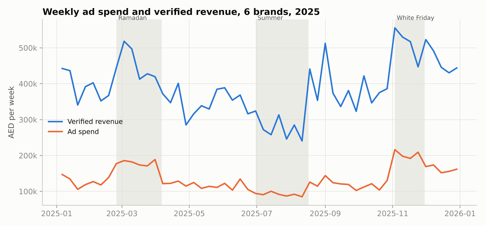

*Figure 8.1: Weekly spend and verified revenue. Shaded bands mark
Ramadan, Summer and White Friday.*

Spend rises sharply in peak seasons, but revenue does not rise in
proportion. Table 8.2 shows why: in Ramadan and White Friday weeks the
return on each dirham falls, because brands spend more (moving further
along their diminishing-returns curves) at the same time as costs per
click rise.

| **Season**           | **Campaign-weeks** | **Spend** | **Verified ROAS** | **% weeks profitable** |
|----------------------|--------------------|-----------|-------------------|------------------------|
| Back to School       | 119                | AED 384k  | 3.40x             | 68%                    |
| Regular              | 1069               | AED 3.09M | 3.05x             | 65%                    |
| Summer               | 288                | AED 641k  | 3.02x             | 67%                    |
| DSF & National Day   | 254                | AED 959k  | 2.89x             | 67%                    |
| Ramadan & Eid        | 251                | AED 1.08M | 2.52x             | 56%                    |
| White Friday & 11.11 | 167                | AED 815k  | 2.51x             | 60%                    |

*Table 8.2: Performance by season.*

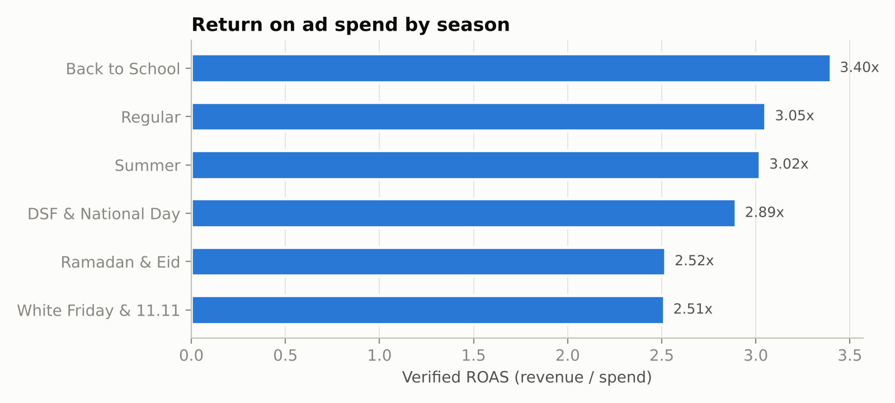

*Figure 8.2: Verified ROAS by season.*

| **Category**            | **Gross margin** | **Break-even ROAS** | **Spend** | **Verified ROAS** | **Contribution** | **% weeks profitable** |
|-------------------------|------------------|---------------------|-----------|-------------------|------------------|------------------------|
| Fragrance & Beauty      | 65%              | 1.54x               | AED 1.77M | 2.73x             | AED 1.37M        | 75%                    |
| Electronics Accessories | 32%              | 3.12x               | AED 1.72M | 2.42x             | -AED 385k        | 36%                    |
| Fashion & Activewear    | 55%              | 1.82x               | AED 1.32M | 2.86x             | AED 753k         | 71%                    |
| Home & Living           | 45%              | 2.22x               | AED 817k  | 3.37x             | AED 423k         | 64%                    |
| Baby & Kids             | 48%              | 2.08x               | AED 729k  | 3.67x             | AED 557k         | 77%                    |
| Health Food & Snacks    | 40%              | 2.50x               | AED 620k  | 3.29x             | AED 197k         | 65%                    |

*Table 8.3: Performance by product category. The same ROAS means very
different things at different margins.*

Table 8.3 is the clearest illustration of Blind spot 2. Voltbay
(electronics accessories) has a verified ROAS of 2.42x, which looks
healthy on a platform dashboard, but its 32% margin means it needs about
3.1x to break even, and its advertising destroyed value over the year.
Oudh Lane has a similar ROAS (2.73x) but, at a 65% margin, generated the
most contribution of any brand.

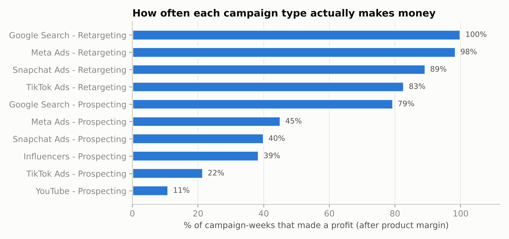

*Figure 8.3: Share of campaign-weeks that made a profit, by channel and
objective.*

Retargeting is almost always profitable on a last-order basis (Google
100%, Meta 98%), while prospecting is much less reliable: Meta 45%,
Snapchat 40%, TikTok 22%, YouTube 11%. Section 17 explains why
retargeting results should be treated with caution: retargeted shoppers
were often going to buy anyway.

# 9. Diagnostic Analytics: the Attribution Truth Check

Summed across channels, the platforms reported **AED 28.18M** of revenue
against **AED 20.23M** recorded by the stores: **AED 7.95M** of
"phantom" revenue, or **39%** more than really happened.

| **Channel**   | **Platform-claimed revenue** | **Verified revenue** | **Claimed ROAS** | **Verified ROAS** | **Over-claim** |
|---------------|------------------------------|----------------------|------------------|-------------------|----------------|
| YouTube       | AED 1.10M                    | AED 579k             | 2.34x            | 1.23x             | +90%           |
| TikTok Ads    | AED 3.98M                    | AED 2.34M            | 3.49x            | 2.05x             | +70%           |
| Snapchat Ads  | AED 4.12M                    | AED 2.56M            | 4.18x            | 2.60x             | +61%           |
| Meta Ads      | AED 9.61M                    | AED 6.56M            | 4.53x            | 3.09x             | +47%           |
| Google Search | AED 7.50M                    | AED 6.42M            | 5.71x            | 4.89x             | +17%           |
| Influencers   | AED 1.86M                    | AED 1.77M            | 1.99x            | 1.89x             | +6%            |

*Table 9.1: Claimed vs verified revenue, ranked by over-claim.*

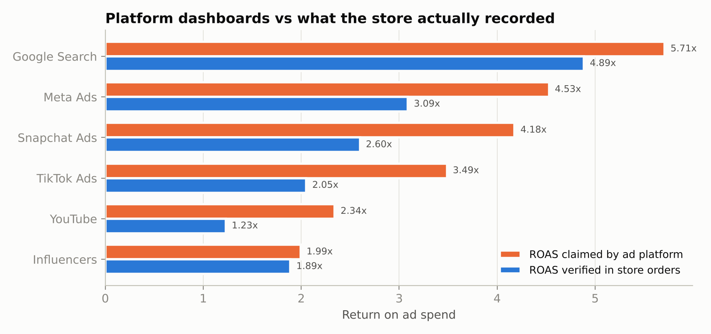

*Figure 9.1: ROAS claimed by each platform vs ROAS verified in store
orders.*

<table>
<colgroup>
<col style="width: 100%" />
</colgroup>
<tbody>
<tr class="odd">
<td>
<strong>Why this matters for decisions</strong>

On platform numbers, Snapchat claims a 4.18x ROAS, which would make
it look more efficient than Meta really is (3.09x verified). On verified
numbers, Snapchat returns 2.60x.

The channels that over-claim most (YouTube, TikTok, Snapchat) are
also the ones with the weakest verified returns. A marketer who follows
the dashboards will systematically move money in the wrong
direction.
</td>
</tr>
</tbody>
</table>

# 10. Predictive Analytics: Will a Campaign Make Money?

## 10.1 Business question and design

Before renewing or launching a campaign for the coming week, a marketer
wants to know: **will it make money after product costs?** This is
framed as binary classification: profitable (contribution \> 0) or not.

To make the model usable in practice, it only uses information known
**before** the week runs: product category and gross margin, channel,
objective, creative format, ad language, target emirate, season,
creative age (weeks since last refresh) and planned spend. Outcome
variables such as clicks or orders are excluded, because including them
would leak the answer into the model.

The data was split **by time**, not at random: the model was trained on
the 1,603 campaign-weeks before 2025-10-06 and tested on the 545 later
weeks, which include White Friday and DSF. This is a stricter test than
a random split because the model must predict a future it has not seen.
Five-fold cross-validation on the training period was used as a
stability check.

## 10.2 Results

| **Model**                                  | **Accuracy** | **Precision** | **Recall** | **F1** | **ROC AUC** |
|--------------------------------------------|--------------|---------------|------------|--------|-------------|
| Random Forest                              | 0.850        | 0.949         | 0.807      | 0.873  | 0.933       |
| Logistic Regression (baseline)             | 0.829        | 0.944         | 0.779      | 0.854  | 0.934       |
| Naive rule (always predict majority class) | 0.638        | n/a           | n/a        | n/a    | 0.500       |

*Table 10.1: Hold-out performance (Oct-Dec 2025). Random Forest 5-fold
CV AUC on the training period: 0.923 ± 0.016.*

|                    | **Predicted: loss**     | **Predicted: profit**      |
|--------------------|-------------------------|----------------------------|
| **Actual: loss**   | 182 (correctly flagged) | 15 (false alarm of profit) |
| **Actual: profit** | 67 (missed opportunity) | 281 (correctly approved)   |

*Table 10.2: Confusion matrix, Random Forest, threshold 0.5.*

The Random Forest classifies **85.0%** of unseen campaign-weeks
correctly, against 63.9% for a naive rule that always predicts the
majority class. Its **precision of 94.9%** matters most commercially:
when it says a campaign will be profitable, it is right 19 times out of
20. It is deliberately cautious (recall 80.7%), which suits budget
decisions: missing some profitable weeks is cheaper than funding losing
ones.

**An honest comparison:** logistic regression achieves almost the same
AUC (0.934 vs 0.933) with slightly lower accuracy. The extra complexity
of the Random Forest is therefore not strongly justified on this data,
mainly because the synthetic generator uses largely multiplicative
effects that a linear model on log-spend can capture. On real data with
stronger interactions (for example, Arabic creative working on Snapchat
but not on Google), the Random Forest would be expected to pull ahead.
AdPulse keeps both models and would choose between them per client on
hold-out performance.

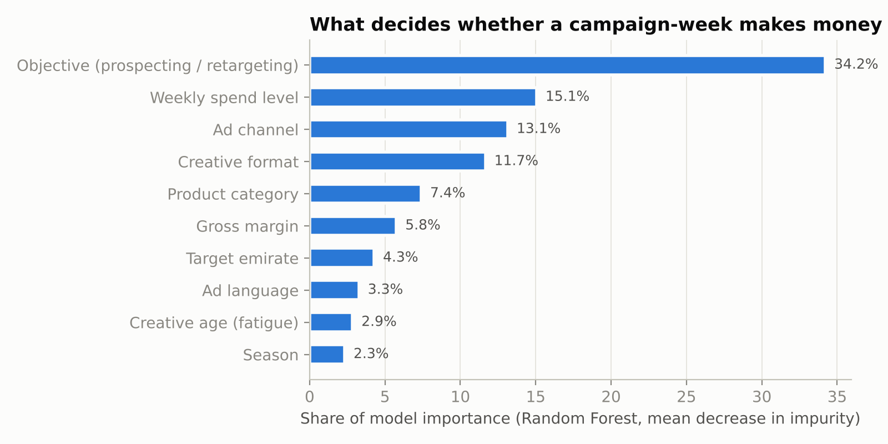

*Figure 10.1: Feature importance (Random Forest, grouped back to
business variables).*

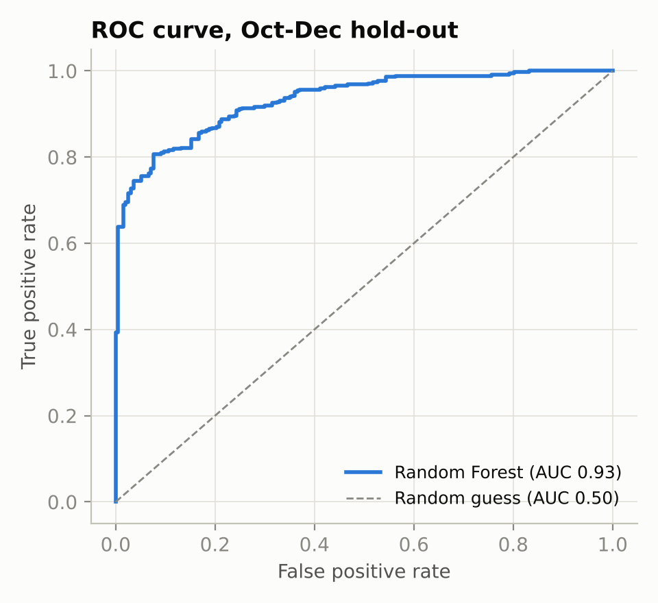

*Figure 10.2: ROC curve on the Oct-Dec hold-out.*

Campaign objective (prospecting vs retargeting) is the most important
driver, followed by **spend level**, which is direct evidence of
diminishing returns: the more a campaign spends in a week, the lower its
chance of profit. Channel and creative format come next. In the app, the
Profit Predictor turns this into an action: for any planned campaign it
shows the probability of profit and lists the alternative channel,
objective and creative combinations with the highest predicted
probability at the same budget.

# 11. Prescriptive Analytics: Budget Optimisation

## 11.1 Method

For each brand and channel, weekly spend and verified revenue were
aggregated and a constant-elasticity response curve was fitted by least
squares on logs (Hanssens et al., 2001):

**ln(revenue) = a + b x ln(spend) + season dummies + error**

Here b is the spend elasticity: b = 0.6 means a 10% increase in spend
raises revenue by about 6%. The curve is converted back to AED with a
smearing correction (Duan, 1983). The optimiser then starts each channel
at 30% of its historical average and repeatedly gives the next block of
budget (1/600th of the total) to the channel with the highest marginal
revenue, until the budget is spent. Two guard-rails keep recommendations
realistic: each channel stays between 0.3x and 2x its historical average
(no extrapolation far outside observed data), and b is constrained to
0.30-0.90.

Of the 28 brand-channel curves, 5 had unconstrained estimates above 0.90
(mostly influencer and YouTube spend, the noisiest channels) and were
constrained. Curve R-squared ranges from 0.27 to 0.75 (median 0.50):
spend explains roughly half of week-to-week revenue variation, which is
typical for weekly marketing data and a reason to roll out changes
gradually.

## 11.2 Results

| **Channel**   | **Elasticity b** | **R²** | **Current spend/week** | **Recommended** | **Marginal ROAS now** |
|---------------|------------------|--------|------------------------|-----------------|-----------------------|
| Google Search | 0.50             | 0.50   | AED 5,489              | AED 11k         | 2.48                  |
| Influencers   | 0.90 \*          | 0.66   | AED 6,092              | AED 2,551       | 1.45                  |
| Meta Ads      | 0.64             | 0.69   | AED 8,499              | AED 12k         | 1.80                  |
| Snapchat Ads  | 0.53             | 0.45   | AED 5,291              | AED 6,167       | 1.69                  |
| TikTok Ads    | 0.63             | 0.60   | AED 6,857              | AED 3,082       | 1.17                  |
| YouTube       | 0.90 \*          | 0.51   | AED 3,930              | AED 1,179       | 1.20                  |

*Table 11.1: Oudh Lane response curves and recommendation. \* =
elasticity constrained to 0.90.*

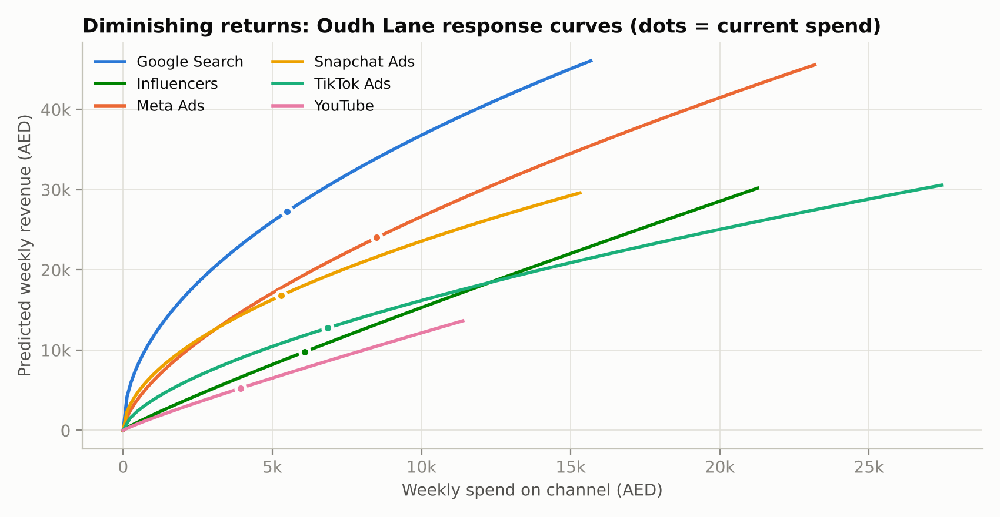

*Figure 11.1: Oudh Lane response curves. Dots show current average
weekly spend.*

The marginal ROAS column is the key decision variable. At current spend,
an extra dirham on Google Search returns about AED 2.48 in revenue,
while an extra dirham on TikTok returns about AED 1.17, which at a 65%
margin barely covers itself. Moving money from the flat curves to the
steep ones raises revenue without raising the budget.

| **Brand**     | **Margin** | **Weekly budget** | **Revenue (current split)** | **Revenue (AdPulse split)** | **Uplift** | **Extra gross profit / year** |
|---------------|------------|-------------------|-----------------------------|-----------------------------|------------|-------------------------------|
| Dar Living    | 45%        | AED 17k           | AED 59k                     | AED 65k                     | +10.0%     | AED 138k                      |
| Greenbite     | 40%        | AED 13k           | AED 43k                     | AED 46k                     | +5.1%      | AED 46k                       |
| Little Nakhla | 48%        | AED 15k           | AED 55k                     | AED 62k                     | +12.8%     | AED 175k                      |
| Oudh Lane     | 65%        | AED 36k           | AED 96k                     | AED 101k                    | +5.3%      | AED 173k                      |
| Sahra Active  | 55%        | AED 26k           | AED 73k                     | AED 76k                     | +3.9%      | AED 81k                       |
| Voltbay       | 32%        | AED 34k           | AED 82k                     | AED 93k                     | +13.4%     | AED 184k                      |

*Table 11.2: Optimiser results by brand at the current budget.*

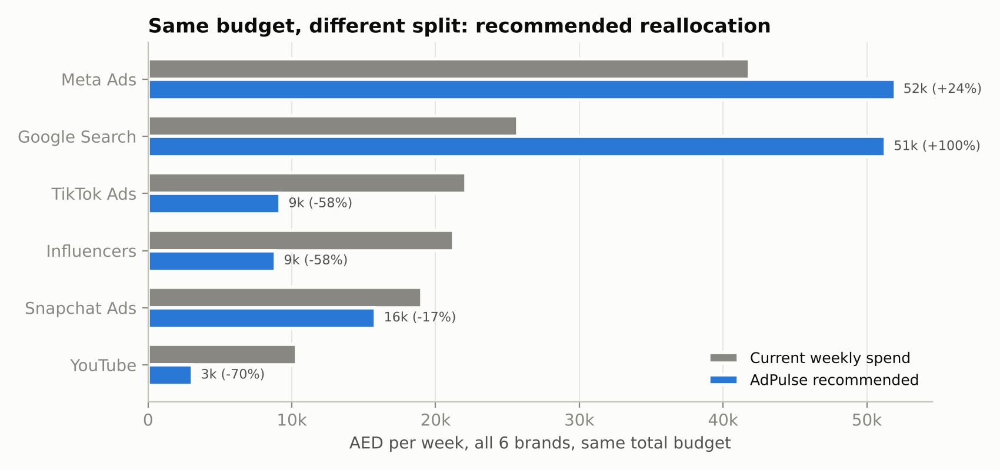

*Figure 11.2: Current vs recommended weekly spend by channel, all
brands, same total budget.*

Across the portfolio, the optimiser recommends roughly doubling Google
Search, increasing Meta, and cutting TikTok, Influencers and YouTube,
for a **8.4% revenue uplift** and about **AED 797k of extra annual gross
profit** with no additional spend. Voltbay still makes a loss after
optimisation: re-allocation reduces the loss but cannot fix a 32% margin
business that relies on paid prospecting. That is a pricing and
product-mix problem, and AdPulse should say so rather than hide it.

# 12. Customer Segmentation and LTV : CAC

## 12.1 K-means segmentation

Customers were clustered on four standardised behavioural variables:
number of orders in 12 months (log), average order value (log), days
since last order and share of orders using a discount code. K-means was
run for k = 2 to 7.

| **k** | **Silhouette score** | **Inertia** |
|-------|----------------------|-------------|
| 2     | 0.210                | 12,625      |
| 3     | 0.234                | 10,229      |
| 4     | 0.250                | 8,301       |
| 5     | 0.248                | 7,001       |
| 6     | 0.236                | 6,476       |
| 7     | 0.226                | 6,005       |

*Table 12.1: Choosing k. Silhouette peaks at k = 4.*

The silhouette score peaks at **k = 4 (0.250)**. A score of about 0.25
means the segments overlap: they are useful groupings for targeting
rather than sharply separated customer types, which is normal for
behavioural data.

| **Segment**              | **Customers** | **Share** | **Orders** | **AOV** | **Recency (days)** | **Discount share** | **12m gross profit** | **Profit share** |
|--------------------------|---------------|-----------|------------|---------|--------------------|--------------------|----------------------|------------------|
| Loyal repeat buyers      | 747           | 19%       | 4.0        | AED 238 | 43                 | 28%                | AED 440              | 42%              |
| Recent big-basket buyers | 1,673         | 42%       | 1.4        | AED 245 | 48                 | 24%                | AED 161              | 34%              |
| Discount-driven shoppers | 930           | 23%       | 1.4        | AED 178 | 64                 | 65%                | AED 111              | 13%              |
| Lapsed one-timers        | 650           | 16%       | 1.3        | AED 227 | 233                | 31%                | AED 136              | 11%              |

*Table 12.2: Segment profiles (averages).*

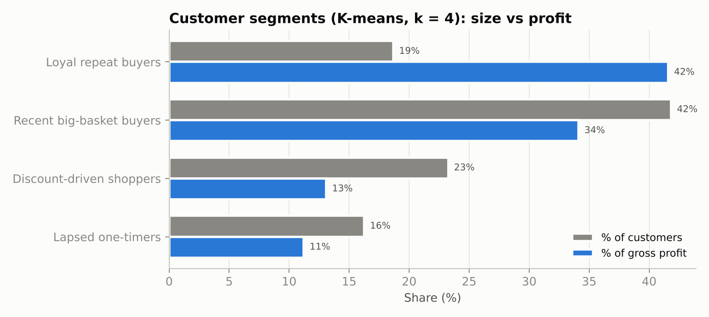

*Figure 12.1: Each segment's share of customers vs share of gross
profit.*

**Loyal repeat buyers** are 19% of customers but generate 42% of gross
profit. **Discount-driven shoppers** are 23% of customers but only 13%
of profit; they rarely return and two-thirds of their orders use a
discount code.

## 12.2 Which channels bring valuable customers?

| **Channel**   | **New customers** | **CAC** | **12m gross profit / customer** | **Repeat rate** | **LTV : CAC** |
|---------------|-------------------|---------|---------------------------------|-----------------|---------------|
| Google Search | 14,674            | AED 90  | AED 242                         | 57%             | 2.71x         |
| Influencers   | 5,341             | AED 175 | AED 219                         | 51%             | 1.25x         |
| Meta Ads      | 13,911            | AED 153 | AED 182                         | 45%             | 1.19x         |
| Snapchat Ads  | 4,907             | AED 201 | AED 167                         | 38%             | 0.83x         |
| YouTube       | 1,550             | AED 303 | AED 222                         | 43%             | 0.73x         |
| TikTok Ads    | 5,080             | AED 224 | AED 111                         | 28%             | 0.49x         |

*Table 12.3: LTV : CAC by acquisition channel.*

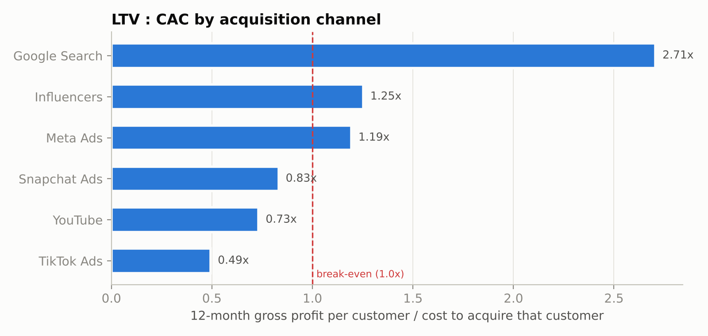

*Figure 12.2: LTV : CAC by channel. Below 1.0x, customers do not repay
their acquisition cost within 12 months.*

The segment mix explains the result. **67%** of TikTok-acquired
customers are discount-driven shoppers and only 3% become loyal repeat
buyers; for Google Search the figures are 1% and 29%. This confirms the
optimiser's recommendation from a completely different angle: TikTok
prospecting is weak on first-order profit **and** on long-term customer
value. The marketing implication is not necessarily to abandon TikTok,
but to use it for awareness with full-price offers rather than
discount-led acquisition.

# 13. Scenario Analysis

The fitted response curves allow 'what-if' questions to be answered for
the whole portfolio. Figures below are per week.

| **Scenario**                     | **Spend** | **Revenue** | **ROAS** | **Gross profit after ads** | **vs base** |
|----------------------------------|-----------|-------------|----------|----------------------------|-------------|
| Base case (current allocation)   | AED 140k  | AED 408k    | 2.91x    | AED 59k                    | \-          |
| AdPulse optimised allocation     | AED 140k  | AED 442k    | 3.15x    | AED 74k                    | +AED 15k    |
| Budget +20%, current allocation  | AED 168k  | AED 455k    | 2.70x    | AED 54k                    | -AED 4,885  |
| Budget +20%, optimised           | AED 168k  | AED 488k    | 2.90x    | AED 68k                    | +AED 9,708  |
| Budget -20%, optimised           | AED 112k  | AED 390k    | 3.47x    | AED 77k                    | +AED 18k    |
| Ad costs +15% (peak-season CPMs) | AED 140k  | AED 375k    | 2.68x    | AED 43k                    | -AED 16k    |
| Ad costs +15%, optimised         | AED 140k  | AED 407k    | 2.90x    | AED 57k                    | -AED 1,477  |
| Demand -10% (soft market)        | AED 140k  | AED 367k    | 2.62x    | AED 39k                    | -AED 20k    |

*Table 13.1: Weekly portfolio outcomes under eight scenarios.*

- **Allocation beats volume.** Re-allocating the current budget adds AED
  15k a week in gross profit. Increasing the budget by 20% on the
  current split **reduces** profit by AED 4,885 a week, because the
  extra money goes mostly into channels that are already saturated.

- **The portfolio is over-spending.** Cutting the budget by 20% **and**
  re-allocating it produces the highest profit of all scenarios (+AED
  18k a week vs base), even though revenue falls. For a profit-focused
  owner, this is the single most important finding.

- **Cost shocks can be absorbed.** A 15% rise in ad costs (typical of
  peak seasons) would cut weekly profit by AED 16k on the current split,
  but only by AED 1,477 if the budget is re-allocated at the same time.

- **Demand risk is the largest.** A 10% fall in consumer demand reduces
  profit by AED 20k a week, which argues for keeping budgets flexible
  rather than locked in quarterly plans.

# 14. Pricing and Break-even

## 14.1 Pricing strategy

AdPulse uses **value-based, tiered subscription pricing**. The anchor is
the value created: in the demo data the optimiser alone is worth about
AED 133k a year in extra gross profit per brand. The Growth tier, at AED
17,880 a year, captures about 13% of that value, leaving a clear return
for the customer. Tiers scale with ad spend under management, so price
grows with the customer's ability to pay.

| **Tier**    | **Price / month** | **Designed for**                                                                            | **Assumed mix** |
|-------------|-------------------|---------------------------------------------------------------------------------------------|-----------------|
| **Starter** | AED 590           | 1 brand, up to AED 40k monthly ad spend, 3 channels, Truth Check and Profit Predictor       | 50%             |
| **Growth**  | AED 1,490         | 1-2 brands, up to AED 200k monthly ad spend, all channels, Budget Optimiser, Customer Value | 40%             |
| **Agency**  | AED 3,900         | Up to 10 brands, white-label reports, API access, quarterly strategy call                   | 10%             |

*Table 14.1: Pricing tiers. Blended average revenue per user (ARPU) =
AED 1,281 per month.*

The price points are hypotheses to be tested with the Van Westendorp
questions in the survey (Q21-Q24).

## 14.2 Unit economics and break-even

| **Assumption / result**                   | **Value**          | **Note**                                                        |
|-------------------------------------------|--------------------|-----------------------------------------------------------------|
| **Fixed costs**                           | AED 95,000 / month | 4-person team, licences and visas, office, tools (illustrative) |
| **Variable cost per subscriber**          | AED 140 / month    | Cloud, data connectors, support                                 |
| **Gross margin per subscriber**           | AED 1,141 (89%)    | ARPU - variable cost                                            |
| **Monthly churn**                         | 4%                 | Average customer lifetime 25 months                             |
| **Cost to acquire a subscriber (CAC)**    | AED 6,000          | Founder-led and partner sales                                   |
| **Customer lifetime value (LTV)**         | AED 28,525         | Gross margin x lifetime                                         |
| **LTV : CAC**                             | 4.75x              | Above the commonly used 3x benchmark                            |
| **CAC payback**                           | 5.3 months         |                                                                 |
| **Break-even subscribers (steady state)** | 84                 | Fixed costs / gross margin per subscriber                       |

*Table 14.2: Unit economics (illustrative assumptions, adjustable in the
app's Business Case page).*

| **Fixed costs / month** | **ARPU AED 1,000** | **ARPU AED 1,281** | **ARPU AED 1,500** |
|-------------------------|--------------------|--------------------|--------------------|
| AED 75k                 | 88                 | 66                 | 56                 |
| AED 95k                 | 111                | 84                 | 70                 |
| AED 120k                | 140                | 106                | 89                 |

*Table 14.3: Sensitivity of break-even subscribers to fixed costs and
ARPU.*

## 14.3 Growth projection

Three 36-month scenarios vary the number of new subscribers in month 1
and the monthly growth in new subscribers (Conservative: 3 and 5%; Base:
4 and 8%; Optimistic: 6 and 10%), with 4% churn. Acquisition spend is
counted as an operating cost, so operating break-even arrives later than
the 84-subscriber steady-state figure.

| **Case**     | **Subs, month 12** | **Subs, month 24** | **Subs, month 36** | **Annualised revenue, month 36** | **Operating break-even** | **Cumulative profit, month 36** |
|--------------|--------------------|--------------------|--------------------|----------------------------------|--------------------------|---------------------------------|
| Conservative | 39                 | 95                 | 185                | AED 2.85M                        | Month 34                 | -AED 2.02M                      |
| Base         | 64                 | 199                | 525                | AED 8.06M                        | Month 26                 | -AED 928k                       |
| Optimistic   | 108                | 406                | 1315               | AED 20.21M                       | Month 21                 | AED 998k                        |

*Table 14.4: 36-month projection.*

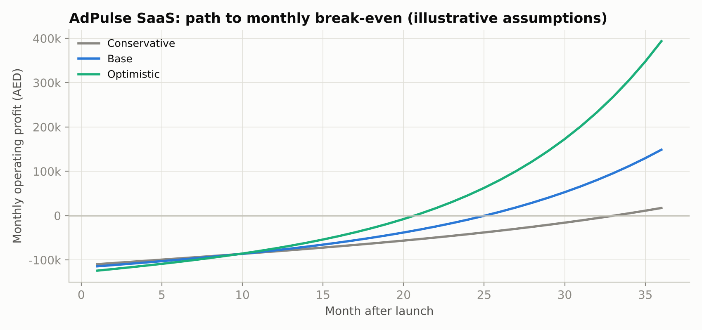

*Figure 14.1: Monthly operating profit under the three scenarios.*

Only the optimistic case recovers its cumulative investment within 36
months. The base case turns cash-positive on a monthly basis in month 26
and would need roughly AED 1.71M of funding to cover cumulative losses
before that, which implies a pre-seed raise or a slower, founder-funded
build. Reaching 525 subscribers by month 36 also probably requires
expansion into Saudi Arabia, which is part of the roadmap.

# 15. Dashboard and Product Design

The prototype is a Streamlit web application with a navigation sidebar,
a brand filter and eight pages. It follows three design rules: **lead
with the money** (every page opens with an AED figure, not a chart),
**say what to do** (cards that say CUT or INCREASE with an amount), and
**show the evidence underneath** (charts, model metrics and method on
the same page). Every chart has hover tooltips, and all tables can be
sorted and downloaded.

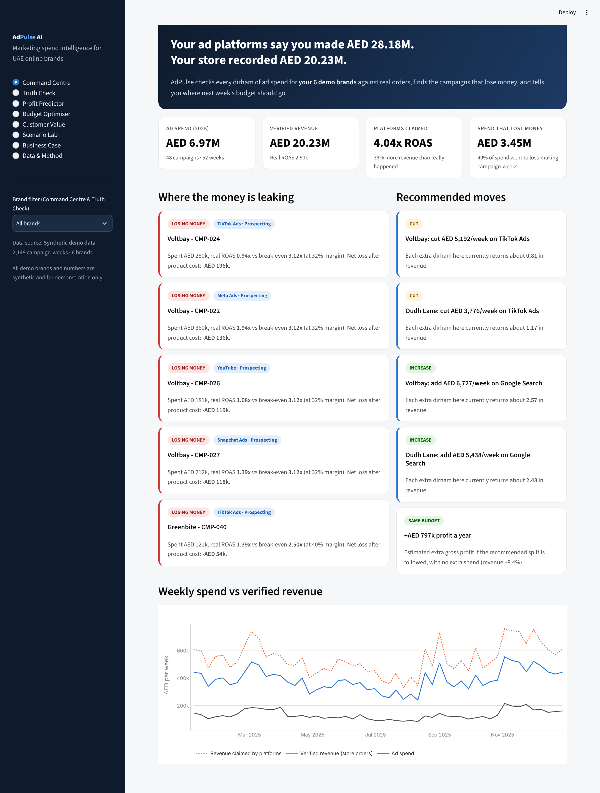

*Figure 15.1: Command Centre: claimed vs verified revenue, money leaks
and recommended moves.*

| **Page**             | **What the user sees and does**                                                                                                                                       |
|----------------------|-----------------------------------------------------------------------------------------------------------------------------------------------------------------------|
| **Command Centre**   | Headline gap between claimed and verified revenue; four KPI tiles; the five biggest money-losing campaigns; recommended cuts and increases with amounts; weekly trend |
| **Truth Check**      | Claimed vs verified ROAS by channel; phantom revenue; reconciliation table                                                                                            |
| **Profit Predictor** | Form for a planned campaign; probability of profit with verdict; better alternatives at the same budget; model accuracy, ROC curve, feature importance                |
| **Budget Optimiser** | Brand selector and budget slider; current vs recommended split; response curves; uplift in revenue and annual profit                                                  |
| **Customer Value**   | Segment cards; segment mix by channel; LTV : CAC chart; adjustable k with silhouette chart                                                                            |
| **Scenario Lab**     | Sliders for budget, ad costs and demand; optimised-split toggle; profit curve across budget levels                                                                    |
| **Business Case**    | Pricing tiers; adjustable cost, churn, CAC, growth and tier mix; break-even, LTV : CAC and 36-month chart                                                             |
| **Data & Method**    | Upload own campaign and customer CSVs (validated); download templates; data preview; methodology                                                                      |

*Table 15.1: Dashboard pages. Screenshots of every page are in
05_Dashboard/screenshots.*

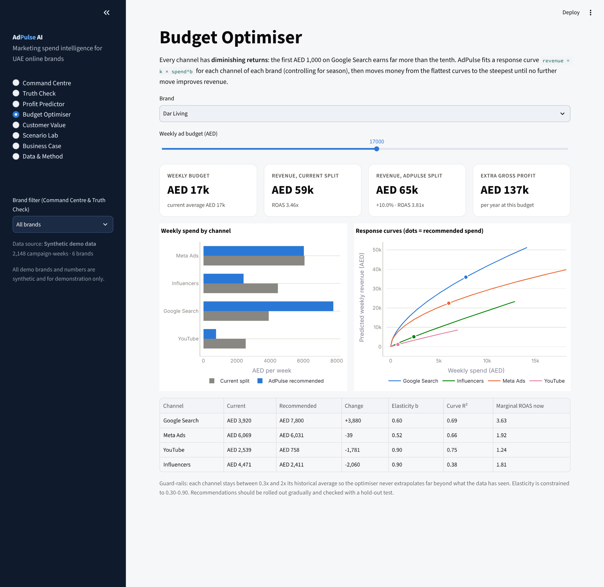

*Figure 15.2: Budget Optimiser.*

# 16. Implementation Roadmap

| **Phase**           | **Timing**   | **Deliverables**                                                                                                                                                  | **Success measure**                                             |
|---------------------|--------------|-------------------------------------------------------------------------------------------------------------------------------------------------------------------|-----------------------------------------------------------------|
| **0. Validate**     | Months 0-3   | Field survey (40-60 responses) and 8-10 interviews; 3 pilot brands using CSV upload in this prototype; refine pricing                                             | H1-H5 tested; 2 of 3 pilots agree to pay                        |
| **1. MVP**          | Months 3-9   | API connectors for Meta, Google, TikTok, Snapchat; Shopify, WooCommerce and Salla order sync; weekly email / WhatsApp digest; Arabic interface                    | 30 paying subscribers; weekly active use \> 60%                 |
| **2. Intelligence** | Months 9-18  | Holdout and geo-test planner to measure true incrementality; Bayesian marketing-mix model; cash-on-delivery and returns-adjusted revenue; creative-fatigue alerts | Optimiser recommendations validated by at least 5 holdout tests |
| **3. Scale**        | Months 18-36 | Agency tier and white-label; KSA expansion; approved budget changes pushed directly to platforms via API                                                          | 525 subscribers (base case); operating break-even               |

*Table 16.1: Roadmap.*

# 17. Risks, Ethics and Limitations

## 17.1 Limitations of this analysis

- **Synthetic data.** All results in Sections 8-13 come from generated
  data. The models recover patterns that the generator built in, so the
  results demonstrate that the pipeline works; they do not prove that
  the same patterns exist in real UAE brands. Real pilot data is
  required.

- **Verified revenue is still attribution.** Matching orders by UTM tags
  and promo codes is more honest than platform self-reporting, but it is
  still not causal. Some verified sales would have happened without any
  ad.

- **Retargeting looks better than it is.** Retargeting reaches people
  who already visited the store and were likely to buy. Its near-100%
  profitability in Section 8 is first-order attribution, not proof of
  incremental value (Blake et al., 2015; Lewis & Rao, 2015). The roadmap
  therefore includes holdout tests.

- **Response curves are correlational.** Weekly spend is chosen by
  marketers (for example, raised before peak seasons), which can bias
  elasticity estimates. Season dummies reduce but do not remove this.
  Recommendations should be phased in and checked with experiments.

- **The profitability classifier ignores repeat purchases.** It predicts
  first-order contribution only; Section 12 covers long-term value
  separately. A future version should predict 12-month contribution.

- **Survey not yet fielded.** Market size, pricing and adoption
  assumptions remain hypotheses until survey and pilot results are
  available.

## 17.2 Business risks

| **Risk**                                             | **Impact** | **Mitigation**                                                                                      |
|------------------------------------------------------|------------|-----------------------------------------------------------------------------------------------------|
| **Ad platforms change APIs or restrict data access** | High       | Support CSV upload as fallback; maintain several connectors; monitor API changelogs                 |
| **Brands unwilling to share store and ad data**      | High       | Read-only access, UAE-hosted data, clear data-processing agreement, CSV-only Starter tier           |
| **Recommendations wrong for a specific brand**       | Medium     | Guard-rails, gradual roll-out, holdout validation, show uncertainty; recommendations, not autopilot |
| **Competition from platforms or global tools**       | Medium     | Focus on UAE specifics, profit framing and SME pricing; build local benchmark data                  |
| **Slow SME adoption and high churn**                 | Medium     | Free Truth Check audit as lead magnet; weekly digest builds habit; annual plans                     |

*Table 17.1: Key business risks.*

## 17.3 Ethics and data protection

AdPulse processes customer order data, which includes personal data. It
must comply with the UAE Personal Data Protection Law (Federal
Decree-Law No. 45 of 2021): processing only for the stated purpose,
minimal data (customer IDs can be hashed; names and addresses are not
needed), secure storage, and a data-processing agreement with each
client. Segmentation is behavioural only; AdPulse does not use or infer
nationality, religion or other sensitive characteristics. The
demonstration data contains no real people.

# 18. Conclusion

AdPulse addresses a problem that UAE online brands face every week and
cannot solve by eye: their advertising numbers are self-reported,
expressed in revenue rather than profit, and blind to diminishing
returns and customer quality. The prototype shows how one product can
turn raw spend and order data into four concrete decisions: which
campaigns to cut, how to split the budget, which channels bring
customers worth keeping, and what to expect if conditions change.

On the demonstration data, the analytics expose a 39% gap between
claimed and real revenue, show that half of spend sat in loss-making
campaign-weeks, predict profitability on unseen weeks with 85% accuracy,
and identify about AED 797k a year of extra profit from re-allocating
the same budget. As a business, AdPulse has attractive unit economics
under stated assumptions (LTV : CAC 4.8x, payback 5.3 months) but needs
funding to reach operating break-even in around two years.

The most important next step is evidence: fielding the survey and
running three pilot brands on real data. The prototype has been built so
that this can start immediately, since any brand can upload its own
exports and see its own numbers.

# 19. AI Use Statement

Generative AI (Claude, by Anthropic) was used in this project to help
write the Python code for the synthetic data generator, the analytics
engine and the Streamlit application; to generate the synthetic
demonstration dataset; and to draft sections of this report. The author
defined the business problem and scope, reviewed and edited the outputs,
and checked that the figures in the report match the result files in
04_Results, which can be regenerated by running 03_Code/generate_data.py
and 03_Code/analysis.py. Market statistics were taken from the published
sources listed below, not generated. The author takes full
responsibility for the content.

# References

AGBI. (2025, October). Ad spend in Gulf growing quicker than rest of
world. Arabian Gulf Business Insight.
https://www.agbi.com/analysis/media/2025/10/ad-spend-in-gulf-growing-quicker-than-rest-of-world/

Blake, T., Nosko, C., & Tadelis, S. (2015). Consumer heterogeneity and
paid search effectiveness: A large-scale field experiment. Econometrica,
83(1), 155-174.

Breiman, L. (2001). Random forests. Machine Learning, 45(1), 5-32.

Duan, N. (1983). Smearing estimate: A nonparametric retransformation
method. Journal of the American Statistical Association, 78(383),
605-610.

Gordon, B. R., Zettelmeyer, F., Bhargava, N., & Chapsky, D. (2019). A
comparison of approaches to advertising measurement: Evidence from big
field experiments at Facebook. Marketing Science, 38(2), 193-225.

Gupta, S., Hanssens, D., Hardie, B., Kahn, W., Kumar, V., Lin, N.,
Ravishanker, N., & Sriram, S. (2006). Modeling customer lifetime value.
Journal of Service Research, 9(2), 139-155.

Hanssens, D. M., Parsons, L. J., & Schultz, R. L. (2001). Market
response models: Econometric and time series analysis (2nd ed.). Kluwer
Academic.

Jin, Y., Wang, Y., Sun, Y., Chan, D., & Koehler, J. (2017). Bayesian
methods for media mix modeling with carryover and shape effects. Google
Inc.

Lewis, R. A., & Rao, J. M. (2015). The unfavorable economics of
measuring the returns to advertising. The Quarterly Journal of
Economics, 130(4), 1941-1973.

Pedregosa, F., et al. (2011). Scikit-learn: Machine learning in Python.
Journal of Machine Learning Research, 12, 2825-2830.

Pixis. (n.d.). Cross-platform attribution without platform bias: How to
build a neutral view of your media mix.
https://pixis.ai/blog/cross-platform-attribution-without-platform-bias-how-to-build-a-neutral-view-of-your-media-mix/

Rousseeuw, P. J. (1987). Silhouettes: A graphical aid to the
interpretation and validation of cluster analysis. Journal of
Computational and Applied Mathematics, 20, 53-65.

TradeArabia. (2026). UAE e-commerce expected to grow to \$18.3bn by
2030.
https://tradearabia.com/News/486918/UAE-e-commerce-expected-to-grow-to-\$18.3bn-by-2030/RET

United Arab Emirates. (2021). Federal Decree-Law No. 45 of 2021
regarding the Protection of Personal Data.

Van Westendorp, P. (1976). NSS Price Sensitivity Meter: A new approach
to study consumer perception of prices. Proceedings of the ESOMAR
Congress.

WAM. (2023). 557,000 SMEs operated in UAE at end of 2022: Minister of
Economy. Emirates News Agency.
https://www.wam.ae/en/article/hszrgtp9-557000-smes-operated-uae-end-2022-minister

WAM. (2026). UAE e-commerce market size reaches AED42.2 billion in 2025.
Emirates News Agency.
https://www.wam.ae/en/article/c2h35yn-uae-e-commerce-market-size-reaches-aed422-billion

# Appendix A: 24-Question Customer Survey

**Title:** How UAE online brands measure their advertising.
**Introduction shown to respondents:** "This 8-minute survey is part of
a business analytics project at SP Jain School of Global Management,
Dubai. It is anonymous. Please answer only if you make or influence
decisions about paid online advertising for a business selling in the
UAE." **Screening:** respondents who answer 'We do not run paid ads' at
Q5 are thanked and exit.

## Section A: Business profile

**Q1.** What is your role?

> Founder / owner · Head of marketing · Performance / digital marketer ·
> Agency (managing clients' ads) · Other

**Q2.** What does your business (or main client) mainly sell?

> Fragrance & beauty · Fashion & accessories · Electronics · Home &
> furniture · Food & health · Baby & kids · Services · Other

**Q3.** Where do you sell online? (select all)

> Own website (Shopify / WooCommerce / Salla / other) · Amazon.ae · Noon
> · Instagram / WhatsApp orders · Other

**Q4.** What is your average monthly spend on paid online advertising?

> Under AED 10k · AED 10-40k · AED 40-100k · AED 100-250k · Over AED
> 250k · Prefer not to say

**Q5.** Which paid channels do you use? (select all)

> Meta (Facebook / Instagram) · Google Search / Shopping · TikTok ·
> Snapchat · YouTube · Influencers · Other · We do not run paid ads

## Section B: Current practice

**Q6.** How often do you review ad results and move budget between
channels?

> Daily · Weekly · Monthly · Only around big campaigns · Rarely

**Q7.** Which source do you mainly trust to judge ad performance?

> Each platform's own dashboard · Google Analytics · Store backend
> (e.g., Shopify orders) · A spreadsheet combining sources · Agency
> report · Not sure

**Q8.** How many hours a week does your team spend compiling ad reports?

> Under 1 · 1-3 · 3-6 · 6-10 · Over 10

**Q9.** Do you calculate profit after product cost for each campaign
(not only ROAS)?

> Always · Sometimes · Never · Not sure what this means

**Q10.** Do you track how many customers from each channel buy again?

> Yes, regularly · Partly · No

**Q11.** Have you ever run a holdout or geo test (turning ads off for a
group to measure the real effect)?

> Yes · No · I don't know what this is

## Section C: Pain points

**Q12.** "When I add up the sales reported by each ad platform, the
total is higher than my real sales."

> 1 Strongly disagree · 2 Disagree · 3 Neutral · 4 Agree · 5 Strongly
> agree · Don't know

**Q13.** "I am confident I know which channel gives my business the best
return."

> 1 Strongly disagree · 2 Disagree · 3 Neutral · 4 Agree · 5 Strongly
> agree

**Q14.** "During Ramadan, White Friday and other peak seasons, I am
unsure whether extra ad spend pays off."

> 1 Strongly disagree · 2 Disagree · 3 Neutral · 4 Agree · 5 Strongly
> agree

**Q15.** "I find it hard to decide how to split my budget between
channels."

> 1 Strongly disagree · 2 Disagree · 3 Neutral · 4 Agree · 5 Strongly
> agree

**Q16.** What is your biggest frustration with measuring your
advertising today?

> Open text

**Q17.** Roughly what share of your ad budget do you think is wasted?

> 0-10% · 10-25% · 25-50% · Over 50% · Don't know

## Section D: Solution fit

**Q18.** Rank these features from most (1) to least (6) useful.

> See real vs claimed revenue by channel · Predict whether a campaign
> will make a profit · Recommend how to split my budget · Show which
> channels bring repeat customers · Test 'what-if' scenarios · Weekly
> summary in Arabic and English

**Q19.** Would you connect your ad accounts and store data to a tool
like this?

> Yes · Yes, if data stays in the UAE and access is read-only · Only by
> uploading CSV files · No

**Q20.** What would stop you from using such a tool? (select up to 2)

> Data privacy · Price · Set-up time · Not sure the recommendations are
> accurate · My team lacks time / skills · Nothing

## Section E: Willingness to pay (Van Westendorp)

Shown with a one-paragraph description of AdPulse. Answers in AED per
month.

**Q21.** At what monthly price would this tool be so cheap that you
would doubt its quality?

> AED \_\_\_\_

**Q22.** At what monthly price would it be a bargain, a great buy for
the money?

> AED \_\_\_\_

**Q23.** At what monthly price would it start to feel expensive, but you
would still consider it?

> AED \_\_\_\_

**Q24.** At what monthly price would it be too expensive to consider?

> AED \_\_\_\_

Optional, after Q24: "Would you like a free Truth Check of your own ad
data? Leave an email." (Stored separately from survey answers.)

# Appendix B: Data Dictionary

### campaign_performance.csv

| **Column**                                       | **Description**                                                                          |
|--------------------------------------------------|------------------------------------------------------------------------------------------|
| **week_start, week_of_year**                     | Monday the week starts; ISO week number                                                  |
| **season**                                       | Ramadan & Eid, White Friday & 11.11, DSF & National Day, Back to School, Summer, Regular |
| **brand, category, gross_margin**                | Fictional brand, its product category and gross margin (0-1)                             |
| **channel, campaign_id, objective**              | Ad channel; campaign identifier; Prospecting or Retargeting                              |
| **creative_format, ad_language, target_emirate** | Creative type; English / Arabic / Bilingual; geographic target                           |
| **creative_age_weeks**                           | Weeks since the creative was last refreshed (fatigue)                                    |
| **spend_aed, impressions, clicks**               | Media delivery for the week                                                              |
| **orders, new_customers**                        | Store-verified orders attributed to the campaign; of which first-time customers          |
| **verified_revenue_aed**                         | Revenue from store-verified orders (UTM / promo code / order ID match)                   |
| **platform_reported_revenue_aed**                | Revenue the ad platform claimed for the same week                                        |
| **roas, contribution_aed, profitable**           | Verified ROAS; revenue x margin - spend; 1 if contribution \> 0                          |

### customers.csv

| **Column**                                             | **Description**                                                |
|--------------------------------------------------------|----------------------------------------------------------------|
| **customer_id, brand, category**                       | Customer identifier and the brand bought from                  |
| **acquisition_channel, first_order_date, tenure_days** | Channel of first order; date; days observed                    |
| **orders_12m, avg_order_value_aed, revenue_12m_aed**   | Orders, average order value and revenue in the first 12 months |
| **gross_profit_12m_aed**                               | Revenue x margin, reduced for discounted orders                |
| **days_since_last_order, discount_order_share**        | Recency; share of orders using a discount code                 |
| **home_emirate**                                       | Delivery emirate                                               |

# Appendix C: Repository Structure and Deployment

| **Path**                                                | **Contents**                                               |
|---------------------------------------------------------|------------------------------------------------------------|
| **01_Report/**                                          | This report (Word and PDF), Markdown version, survey       |
| **02_Data/**                                            | campaign_performance.csv, customers.csv (synthetic)        |
| **03_Code/app.py**                                      | Streamlit application (main file for deployment)           |
| **03_Code/adpulse_engine.py**                           | All analytics, shared by the app and the analysis script   |
| **03_Code/generate_data.py**                            | Recreates the synthetic data (fixed seed)                  |
| **03_Code/analysis.py**                                 | Recreates every table and chart in 04_Results              |
| **04_Results/**                                         | CSV result tables and PNG charts used in this report       |
| **05_Dashboard/**                                       | Dashboard specification and screenshots of all eight pages |
| **.streamlit/config.toml, requirements.txt, README.md** | Theme, Python dependencies, instructions                   |

### Deploying to Streamlit Community Cloud

1.  Create a new GitHub repository and upload the contents of the
    AdPulse_AI_Submission folder, keeping the folder structure
    (requirements.txt must be at the top level).

2.  Sign in at share.streamlit.io with GitHub and choose Create app,
    then Deploy a public app from GitHub.

3.  Select the repository and branch, and set the Main file path to
    03_Code/app.py.

4.  Click Deploy. The first build installs the packages in
    requirements.txt and takes a few minutes.

To run locally: pip install -r requirements.txt, then streamlit run
03_Code/app.py. To reproduce all results: python
03_Code/generate_data.py, then python 03_Code/analysis.py.
